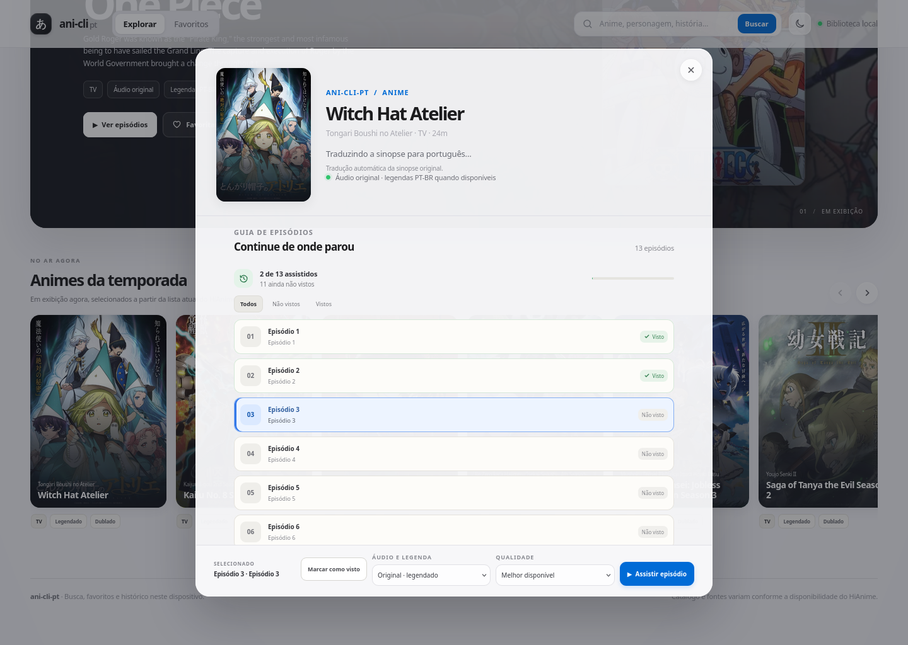
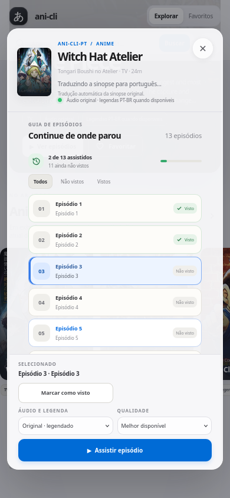

# ani-cli-pt

Uma versão do [ani-cli](https://github.com/pystardust/ani-cli) com foco em legendas em português. Pesquise e reproduza animes direto do terminal, mantendo a interface e o fluxo simples do projeto original.

## O que muda nesta versão

- O modo legendado continua usando o áudio original.
- O ani-cli-pt prefere uma faixa identificada como português ou pt-BR quando ela está disponível no servidor do episódio.
- Se não encontrar português, tenta uma faixa em inglês; se ela não estiver identificada, usa a faixa padrão do servidor.
- Busca, seleção de episódios, histórico, qualidade, player e demais opções continuam seguindo o ani-cli.

A disponibilidade e a identificação das faixas dependem do episódio e do servidor. Por isso, a legenda em português não está disponível em todos os casos.

## Instalação no CachyOS e Arch Linux

Instale os requisitos:

```bash
sudo pacman -S mpv fzf curl grep sed git
```

Clone a branch do ani-cli-pt e inicie o programa:

```bash
git clone --branch ani-cli-pt https://github.com/kauessilvas/ani-cli-pt.git
cd ani-cli-pt
./ani-cli
```

O `mpv` reproduz os vídeos e o `fzf` fornece os menus interativos. O `curl`, `grep` e `sed` são usados pelo script.

## Uso

Abra o menu de busca:

```bash
./ani-cli
```

Ou passe o título diretamente:

```bash
./ani-cli "Attack on Titan"
```

Para selecionar o primeiro resultado e começar pelo episódio 1:

```bash
./ani-cli -S 1 -e 1 "Attack on Titan"
```

Consulte todas as opções disponíveis:

```bash
./ani-cli --help
```

## Opções úteis

| Comando | Ação |
| --- | --- |
| `./ani-cli --dub` | Reproduz a versão dublada, quando disponível |
| `./ani-cli -q 1080 "Naruto"` | Solicita vídeo em 1080p |
| `./ani-cli -d "Naruto"` | Baixa o episódio no diretório atual |
| `./ani-cli --vlc` | Usa o VLC como player |
| `./ani-cli -c` | Continua a partir do histórico |

No mpv, pressione `v` para alternar a exibição das legendas.

## Atualização

Dentro da pasta clonada, atualize a branch com:

```bash
git pull --ff-only
```

## Testar a seleção de legendas

O repositório inclui testes locais para a preferência por pt-BR e os fallbacks:

```bash
sh tests/test-subtitle-selection.sh
```

## Créditos e licença

O ani-cli-pt é um fork do [pystardust/ani-cli](https://github.com/pystardust/ani-cli), cujo código e fluxo servem de base para este projeto. As alterações desta versão concentram-se na seleção de legendas e na experiência em português.

Este projeto mantém a licença GPL-3.0 do ani-cli. Consulte [LICENSE](./LICENSE) e o [aviso de uso](./disclaimer.md).

## Interface web local

O ani-cli-pt também inclui uma interface web local para explorar o catálogo e assistir no player integrado ao navegador. Ela usa o script `ani-cli` deste repositório para localizar a fonte e manter a preferência de legendas do projeto. O `mpv` continua disponível para o uso pelo terminal.

A home destaca o anime mais bem colocado na lista atual de séries em exibição e traz um carrossel para descobrir outros títulos da temporada, com banner e pôster em alta resolução e busca permanente. Favoritos e histórico de episódios ficam salvos no navegador atual; o histórico marca um episódio quando a reprodução começa e permite registrar ou corrigir o status manualmente. O seletor diferencia episódios vistos e não vistos e adapta a lista para telas menores.

### Capturas da interface

Na home, o destaque vem do topo da lista atual de animes em exibição. O carrossel mostra outros títulos da temporada.

<p align="center">
  
  
</p>

O guia de episódios exibe o progresso salvo neste navegador e permite filtrar a lista por episódios vistos e não vistos.

<p align="center">
  
  
</p>

Requisitos para a interface web: Python 3, fzf, curl, grep e sed, além de um navegador moderno com reprodução HLS. O `mpv` é necessário para reproduzir pelo terminal. No Arch Linux/CachyOS, instale os pacotes com:

```bash
sudo pacman -S python mpv fzf curl grep sed
```

Inicie o servidor dentro da pasta do projeto:

```bash
./web/start.sh
```

Depois abra <http://127.0.0.1:8765> no navegador. Mantenha o terminal aberto enquanto usa a interface; `Ctrl+C` encerra o servidor. O serviço escuta apenas no próprio computador por padrão. A interface consulta o catálogo externo e reproduz HLS no player do navegador; o mpv permanece para o fluxo de terminal.

Esta interface precisa do servidor Python e do script `ani-cli`; o GitHub Pages, sozinho, não executa esses componentes.

Ao abrir os detalhes de um anime, a sinopse pública do catálogo é enviada ao [MyMemory](https://mymemory.translated.net/doc/spec.php) para tradução automática para PT-BR. A tradução é mantida em cache enquanto o servidor estiver aberto. Se o serviço falhar ou atingir a cota anônima de [5.000 caracteres por dia](https://mymemory.translated.net/doc/usagelimits.php), a página mostra a sinopse original e oferece a opção de consultá-la.

Execute os testes automatizados da interface/servidor com:

```bash
python3 -m unittest discover -s web/tests -v
```
