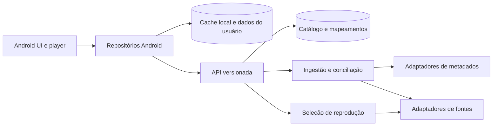

# Plano de integração: catálogo, identidade e fontes

## Objetivo

O aplicativo deve mostrar um catálogo coerente e pesquisar títulos sem depender da estrutura de uma fonte de vídeo. A API mantém a identidade e a disponibilidade; cada fonte fornece apenas as capacidades que realmente tem. A troca ou queda de uma fonte não altera o ID de um anime nem apaga favoritos e histórico.

O problema atual está concentrado em `AnimeRepository`: busca fontes e AniList, agrupa títulos por nome/temporada, carrega imagens, procura episódios e resolve reprodução. `Anime.slug` também funciona como identidade em favoritos, histórico e chaves de cache. Por isso, uma mudança de endereço ou uma duplicata na fonte atravessa todo o fluxo.

## Modelo de domínio

| Entidade | Responsabilidade | Identidade |
| --- | --- | --- |
| `Work` | Agrupa lançamentos relacionados para navegação, como série e filmes | `workId` interno e estável |
| `Release` | Unidade de catálogo: temporada, filme, OVA ou parte quando for um lançamento distinto | `releaseId` interno e estável |
| `Episode` | Episódio dentro de um lançamento; guarda tipo, ordem e, se conhecido, numeração absoluta | `episodeId` interno e estável |
| `ProviderEntry` | Página ou item em uma fonte, associado a um `Release` | `(providerId, externalId)` |
| `ProviderEpisode` | Episódio disponível naquela fonte, associado a um `Episode` | `(providerId, externalEpisodeId)` |
| `PlaybackVariant` | Capacidade observada para um episódio: idioma do áudio, legendas, qualidade e estado | variante da fonte; pode expirar |
| `ExternalId` | Referência de metadados, como AniList ou outra base | `(authority, externalId)` |

`Work` serve para agrupar a interface; não autoriza reproduzir o episódio de outro `Release`. A API usa UUIDs próprios. IDs externos ajudam na conciliação, mas podem faltar ou mudar. URLs, slugs, nomes e rótulos de temporada são atributos, nunca chaves do domínio. Relacionamentos entre lançamentos têm tipo (`SEQUEL`, `PREQUEL`, `SIDE_STORY`, `ALTERNATIVE` etc.) e são separados da equivalência entre entradas de fontes.

Os metadados de apresentação ficam em `Release` com proveniência e idioma: título preferido em pt-BR quando existir, aliases, sinopse, capa, banner, formato, ano, classificação e tags. Dados desconhecidos permanecem `unknown`; não se transformam em "não". A disponibilidade fica em uma tabela separada e só é considerada atual pelo prazo de validade da checagem.

## Limites entre componentes

- **API:** expõe catálogo, busca, relações, disponibilidade e seleção de fontes. Não mantém estado pessoal de favoritos/histórico na primeira versão.
- **Adaptadores de metadados:** devolvem títulos, aliases, formatos, relações, tags e imagens em um contrato comum. Não decidem disponibilidade.
- **Adaptadores de fontes:** implementam capacidades independentes (`search`, `details`, `episodes`, `resolve`); uma fonte só de fallback pode implementar apenas busca restrita e resolução. Cada adaptador traduz o site para dados tipados, sem regras de agrupamento globais.
- **Serviços de domínio:** conciliação de identidade, qualidade dos metadados, estado de disponibilidade, mapeamento de episódios e política de seleção de reprodução. Dependem de interfaces, não de nomes ou domínios de sites.
- **Android:** renderiza modelos da API, mantém dados do usuário localmente, abre o player com a URL/headers/legendas retornados e faz nova resolução se a URL expirar ou falhar. A UI não interpreta slug para descobrir fonte ou temporada.

Kotlin + Ktor é uma escolha inicial coerente com o aplicativo Android; PostgreSQL guarda identidades/mapeamentos e um cache local com Room guarda a leitura recente no aparelho. Isso é uma escolha de implementação, não uma exigência do modelo. Começar como um único serviço modular, sem microsserviços.

## Conciliação de identidade sem regras por anime

1. **Coleta:** o adaptador entrega observações com IDs da fonte, títulos, aliases, formato, ano, relações, episódios e evidências de idioma. Guarda-se o dado bruto e a data da coleta para depuração.
2. **Candidatos:** busca por `ExternalId` confiável e mapeamento já confirmado; depois aliases normalizados e relações de metadados. Normalização remove diferenças superficiais de escrita, mas não apaga informações de temporada, parte, filme e especial.
3. **Restrições:** formato incompatível, relações do tipo continuação em vez de equivalência, ano conflitante sem explicação e episódios incompatíveis impedem fusão automática. Ausência de um campo reduz confiança; não significa igualdade.
4. **Decisão:** pontuação pondera evidências independentes. Vínculo automático só quando houver margem clara sobre o segundo candidato e nenhuma restrição. Caso ambíguo fica separado, com `status=NEEDS_REVIEW`, sem ser usado como fallback cruzado.
5. **Persistência:** cada vínculo guarda evidências, versão do algoritmo, confiança e origem. Uma decisão manual de unir ou separar prevalece em novas coletas; mudanças são auditáveis e reversíveis.

Valores exatos de pontuação e limiares devem ser calibrados com um conjunto de casos rotulados, não escolhidos por exemplos isolados. O mapeamento de episódios usa `releaseId`, tipo, ordem, numeração local/absoluta e dados de origem; igualdade de número sozinha não basta. O catálogo pode ter um único card por `Work`, mas seleção de temporada e reprodução sempre usam `Release` e `Episode` explícitos.

## Casos de uso e fluxos

| Caso | Fluxo esperado |
| --- | --- |
| Abrir início | Android lê cache local imediatamente; a API devolve seções de `Release`/`Work` e atualizações. A seleção de destaque usa metadados prontos, sem busca simultânea em todas as fontes. |
| Pesquisar | API busca índice canônico e devolve um resultado por lançamento ou agrupamento de série, com aliases e disponibilidade conhecida. Fonte nova não cria card duplicado. |
| Abrir detalhes | API entrega metadados, relações e temporadas agrupadas por `releaseId`; cada temporada aparece uma vez. Episódios são carregados por lançamento. |
| Filtrar conteúdo adulto | API aplica classificação/tags consolidadas; Android repete a regra de visibilidade no cache. Classificação desconhecida segue uma política explícita do produto, nunca inferida apenas pela capa. |
| Assistir | Android solicita resolução por `episodeId`, preferência de áudio/legenda e lista de variantes já falhadas. API seleciona entradas confirmadas, resolve em paralelo controlado e devolve URL de curta duração, headers, legendas e ID da variante. |
| Falha no vídeo | Android informa o ID da variante falhada e solicita outra. API evita a mesma variante, respeita idioma/legenda e registra saúde da fonte. Fallback só de reprodução não participa do catálogo. |
| Nova fonte ou site alterado | Um adaptador muda; IDs de `Release`, `Episode`, favoritos e histórico permanecem. Um adaptador indisponível perde disponibilidade após expirar a checagem, sem apagar o catálogo. |
| API indisponível | Android mostra o último catálogo armazenado e preserva ações locais. Reprodução tenta apenas mapeamentos/URLs ainda válidos; se não houver, informa indisponibilidade e permite tentar de novo. |

### Contrato inicial da API

`GET /v1/home`, `GET /v1/search?q=`, `GET /v1/releases/{id}`, `GET /v1/releases/{id}/episodes` e `POST /v1/playback/resolve`. A resposta usa campos tipados (`audioLanguage`, `subtitleLanguages`, `subtitleKind`, `availability`, `checkedAt`, `expiresAt`) e nunca texto de UI como evidência. `POST /v1/playback/report-failure` pode ser adicionado quando a seleção alternativa estiver pronta. Respostas têm versão do esquema, paginação onde couber e erros distinguindo `NOT_FOUND`, `UNAVAILABLE`, `NO_COMPATIBLE_AUDIO`, `SOURCE_TIMEOUT` e `AMBIGUOUS_IDENTITY`.

Exemplo resumido: `POST /v1/playback/resolve { episodeId, audio: "ja", subtitles: ["pt-BR"], excludedVariantIds: [] }` devolve `{ variantId, url, headers, audioLanguage, subtitleTracks, expiresAt }`. Preferências podem admitir `any` explicitamente; a API não troca idioma silenciosamente. URLs e headers sensíveis não são gravados no catálogo nem em logs.

## Etapas de desenvolvimento

| Etapa | Entrega verificável |
| --- | --- |
| 0. Diagnóstico | Inventário dos fluxos atuais e medições no celular: tempo de início, busca, detalhes, episódios e reprodução; amostra rotulada com duplicatas, temporadas, filmes, partes, dublagem e legendas. |
| 1. Domínio e contratos | Esquema, migrações, interfaces de adaptador, respostas JSON versionadas e testes de contrato. Implementar um adaptador de metadados e uma fonte antes de ampliar. |
| 2. Catálogo e identidade | Ingestão agendada, índice de busca, conciliação com trilha de evidências, fila de revisão e operação manual de unir/separar. Testar que uma entrada de fonte removida não apaga o lançamento. |
| 3. Episódios e reprodução | Mapeamento por lançamento/episódio, capacidades reais de áudio/legenda, seleção de variantes, falha e fallback. Fonte de fallback continua fora de home, busca e metadados. |
| 4. Migração Android | Introduzir interface `CatalogRepository`/`PlaybackRepository` e cliente HTTP sem trocar UI de uma vez; cache local; mapear slugs antigos para IDs novos; migrar favoritos, histórico, progresso e snapshots mantendo backup e idempotência. |
| 5. Ativação gradual | Comparar API e fluxo antigo em modo de leitura, registrar divergências, liberar por funcionalidade, testar no celular e remover lógica antiga apenas após estabilidade. |

Para a migração, guardar `legacyProviderId + legacySlug -> releaseId` e `legacyEpisodeKey -> episodeId`. Registros sem correspondência ficam preservados e podem ser resolvidos mais tarde; não são descartados. A API deve expor uma rota interna de mapeamento em lote para evitar uma requisição por item salvo.

## Critérios de aceitação e medição

- Nenhuma fusão incorreta no conjunto rotulado crítico (temporada/filme/OVA/parte); ambiguidades ficam separadas. A cobertura de vínculos automáticos é medida à parte.
- Busca e home não exibem duplicatas para entradas confirmadas da mesma obra/lançamento; temporadas distintas permanecem navegáveis.
- Cada lançamento e episódio mantém o mesmo ID após troca de fonte, título, imagem ou URL.
- Rótulos de áudio e legenda vêm de capacidade observada na variante/episódio, com estado `unknown` quando não houve confirmação.
- Fontes de fallback de reprodução não alimentam catálogo nem classificação de conteúdo.
- Favoritos, histórico e posição de reprodução sobrevivem à migração, inclusive itens ainda sem mapeamento.
- Medir no mesmo aparelho e rede p50/p95 de início, busca, detalhes, episódios, tempo até vídeo, cache hit, taxa de falha por fonte, uso de dados e taxa de resultados ambíguos. Comparar com a linha de base da etapa 0 antes de definir metas de latência.

## Decisões que precisam ser explícitas antes da implementação

1. O card da busca representa um `Release` ou um `Work` com temporadas agrupadas? Recomendo `Work` na busca, com lançamento explícito ao abrir detalhes.
2. Qual a política de títulos com classificação adulta desconhecida quando o filtro estiver ativo? Precisa ser definida para que API e cache Android concordem.
3. Onde a API será hospedada e qual é o orçamento de operação? Isso define cache, frequência de coleta e limites de concorrência.

Essas decisões não impedem as etapas 0 e 1. O contrato de domínio preserva as duas formas de apresentação e não fixa uma fonte de metadados.
